# ODD 다이어그램 — L0 로그 · ① ObjectId · ② Provenance

> 데이터 모델링 ①②까지 시각화. VSCode Mermaid 프리뷰 또는 GitHub에서 바로 렌더됨.
> 먼저 흐름도(flowchart/sequence)로 구조를 잡고, §10 UML(classDiagram)로 스키마 정밀화.
> 상세: [odd-log-schema-L0.md](./rfc/odd-log-schema-L0.md) · [odd-object-model.md](./rfc/odd-object-model.md) · [odd-l1-provenance.md](./rfc/odd-l1-provenance.md)

---

## 1. 레이어 스택 — 로그가 진실, 나머지는 파생

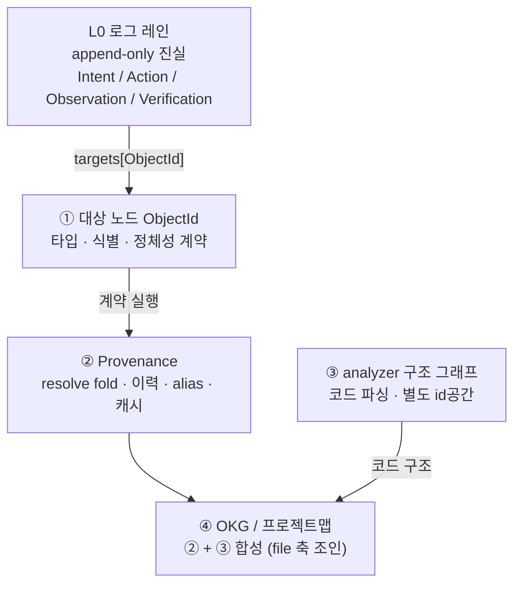

- 코드 구조(import/calls)는 ③ analyzer, 의도·이력은 L0+②. 둘은 `file:` 경로를 공유 축으로 ④에서 조인.

## 2. L0 로그 = 진실, ② = 파생 뷰

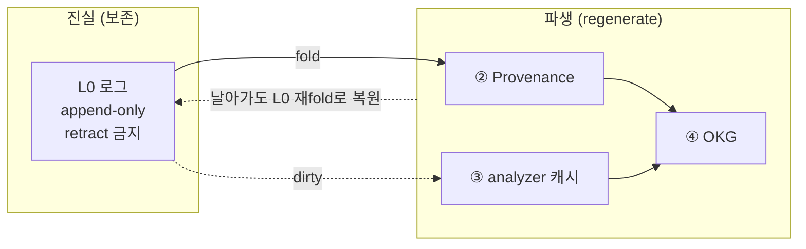

## 3. ① 대상 노드 — 7종 (file + 로그네이티브 6)

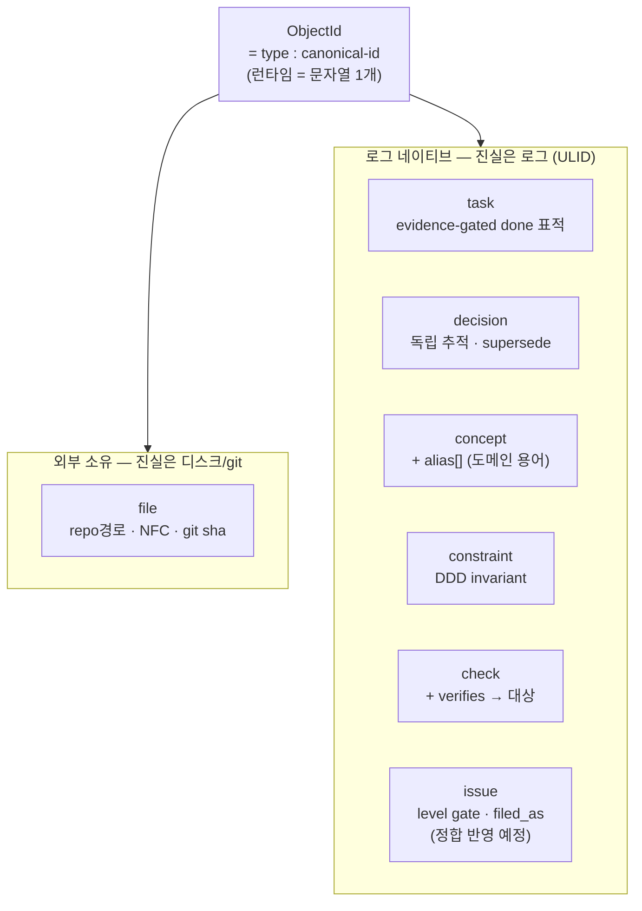

- 제외: `method` = 약참조(③ analyzer regenerate) · `adr` = file + decision 분해.

## 4. 식별 — ULID 발급 ↔ 조회 분리 (핵심 교정)

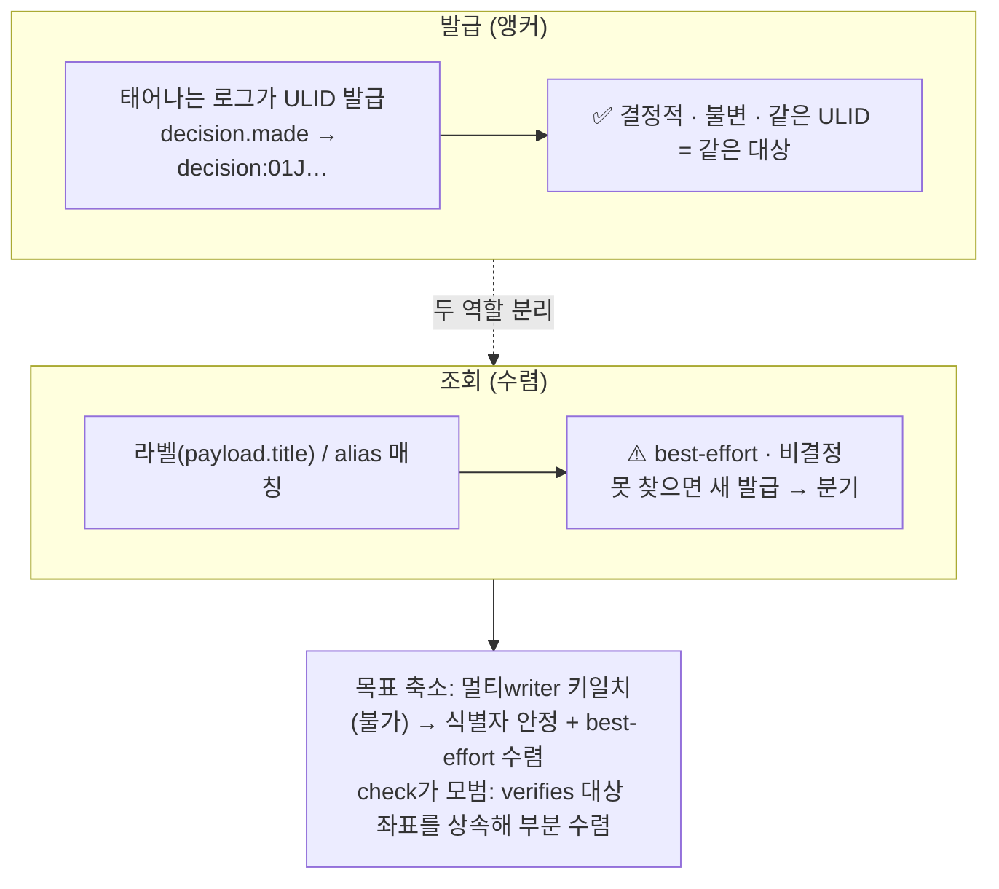

## 5. 정체성 연속 어휘 — 방향은 payload, targets는 단방향 집합

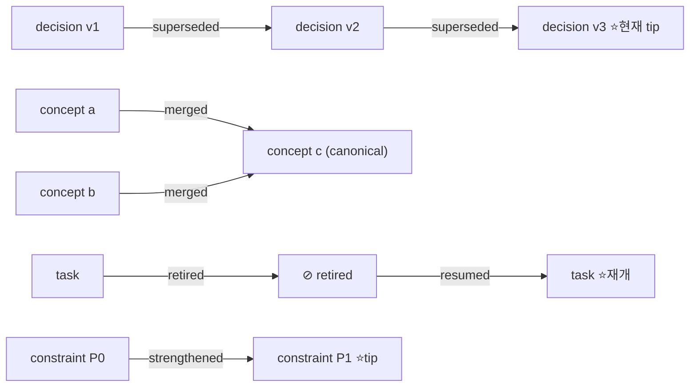

| 어휘 | 성격 | 적용 타입 |
|---|---|---|
| renamed | 정체성 | file |
| superseded | 정체성 (라인 종료) | decision · task |
| merged / split | 정체성 (합류/분기) | concept |
| weakened / strengthened | 정체성 + predicate 변경 | constraint |
| amended | 비정체성 (내용 진화) | 전 로그네이티브 |
| retired / resumed | 정체성 (종료/재개) | task · check · issue |
| aliased | 비정체성 (라벨 lookup) | concept |

## 6. ② resolve() — 정체성 fold

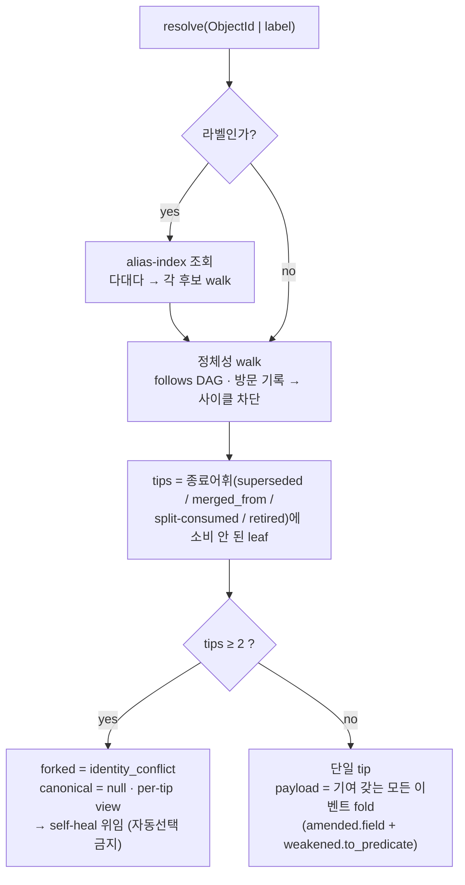

- **v1 버그 수정**: tip을 "전진 어휘 열거"로 정의했더니 weakened/strengthened가 빠졌음 → "종료 안 된 leaf"로 일반화해 자동 포함.

## 7. evidence-gated completion — task.done 게이트

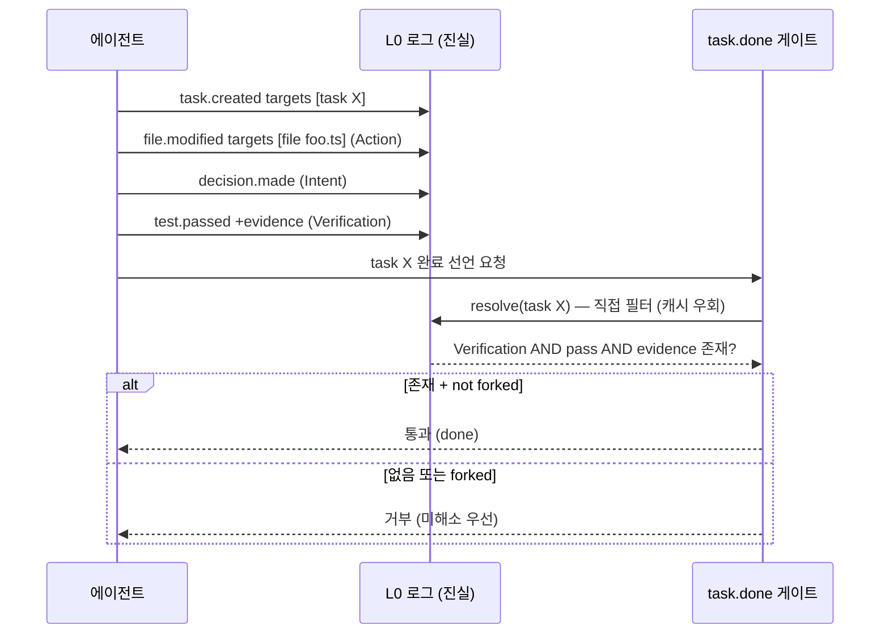

## 8. 게이트 freshness — stale truth 차단 (안전 최우선)

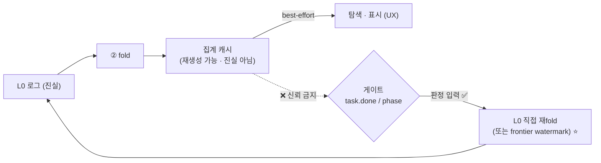

- ② 캐시는 파생이라 "진실 아님" — 하지만 게이트가 그걸 믿으면 stale truth가 판정으로 부활. 그래서 판정 입력은 항상 L0 직접.

## 9. 캐시 2-plane — file vs ULID

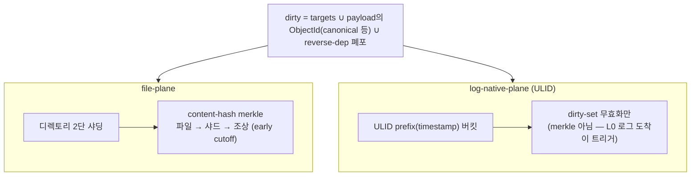

---

## 10. UML — 스키마 정밀화 (classDiagram)

> §1~9 흐름이 확정되면 여기를 정교화. 아래는 기본 골격.

### 10.1 L0 LogEntry

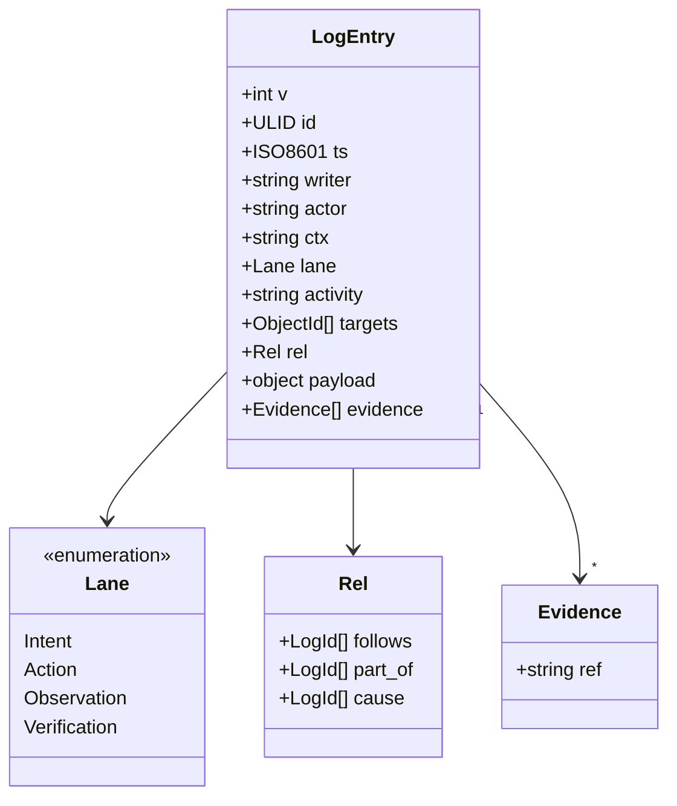

### 10.2 ① ObjectId 타입 계층

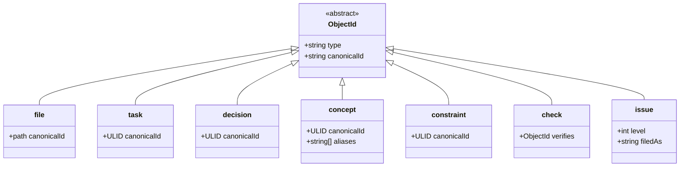

### 10.3 ② ProvenanceView (resolve 반환)

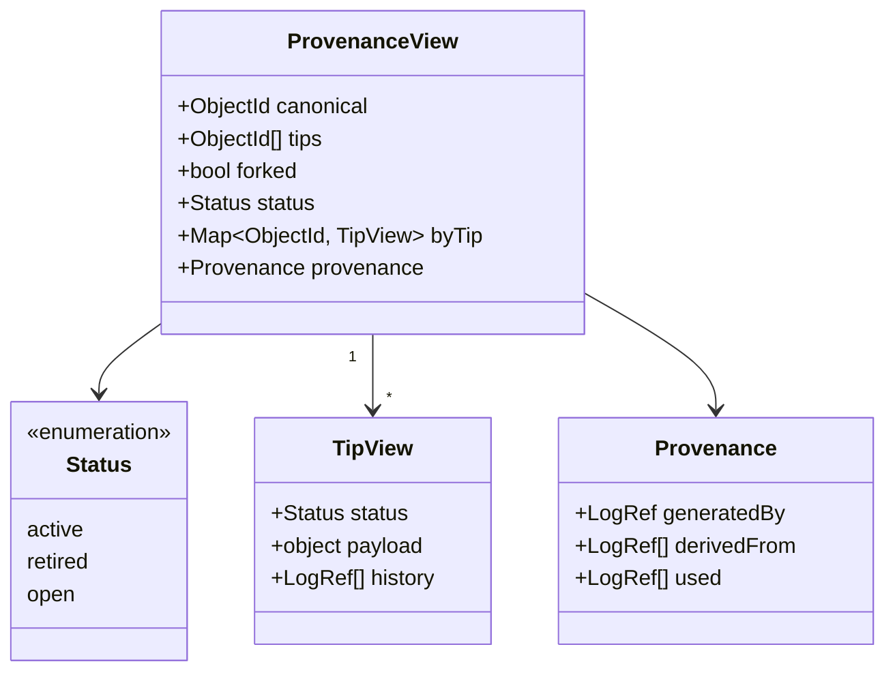
